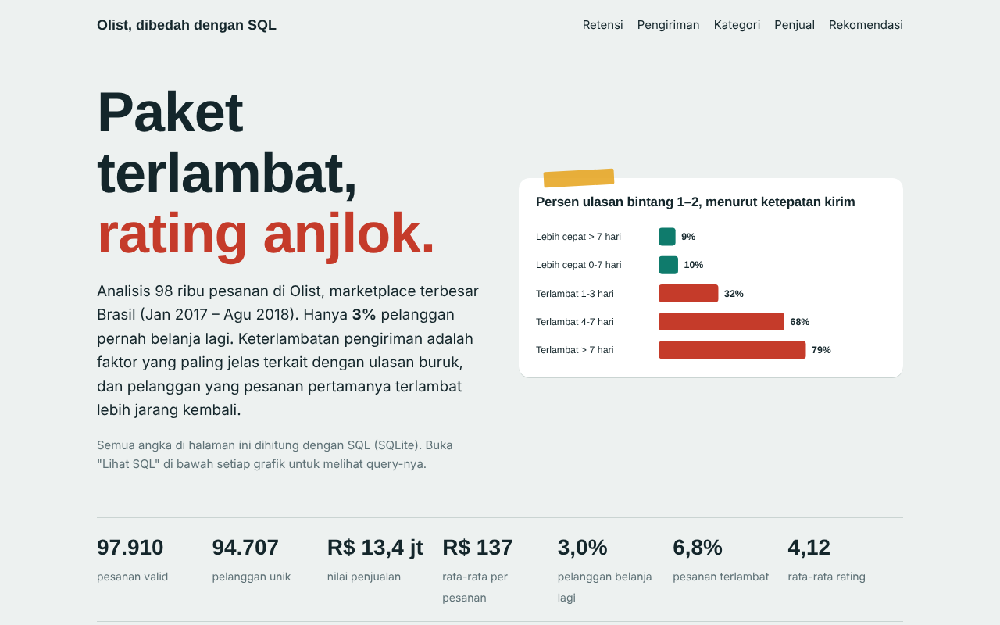
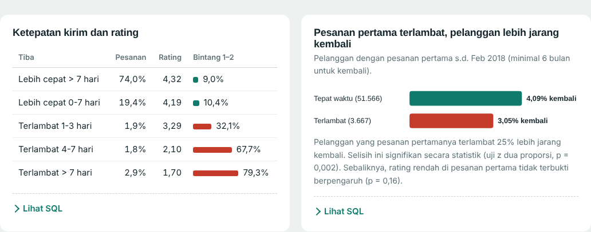
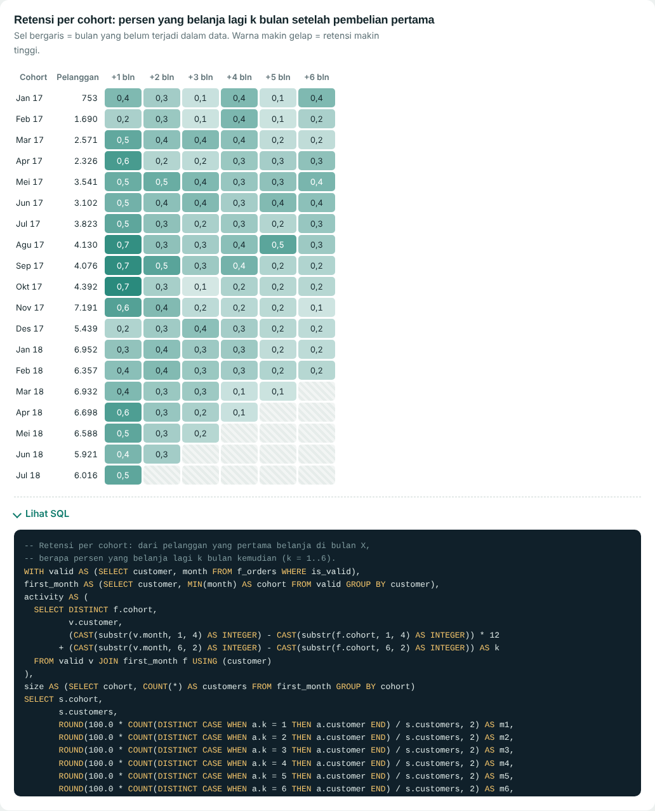

# Olist dibedah dengan SQL

Analisis 98 ribu pesanan e-commerce Brasil (Olist, Jan 2017 – Agu 2018) dengan SQL: retensi pelanggan, segmentasi RFM, dampak keterlambatan pengiriman, kategori, penjual, dan rekomendasi bisnis.

**[Buka dashboard](https://rivaldimhr.github.io/ecommerce-sql-analysis/)** · **[Rekomendasi satu halaman](docs/rekomendasi.md)** · **[Semua query](sql/analysis/)**



## Pertanyaan bisnis dan jawabannya

| Pertanyaan | Jawaban singkat | Query |
|---|---|---|
| Apakah pelanggan kembali belanja? | Hampir tidak: hanya **3,0%** pelanggan belanja lebih dari sekali, dan kurang dari 1% kembali di bulan berikutnya. | [03](sql/analysis/03_cohort_retention.sql), [04](sql/analysis/04_rfm_segments.sql) |
| Apa yang membuat pelanggan kecewa? | Keterlambatan. Terlambat lebih dari 7 hari: rata-rata **1,7 bintang**, 79% ulasan bintang 1–2. Tepat waktu: sekitar 10%. | [06](sql/analysis/06_delivery_vs_review.sql) |
| Kecepatan atau ketepatan janji? | Janji. Lama kirim sama (15–21 hari): tepat estimasi **4,18** bintang, terlambat **2,91**. | [13](sql/analysis/13_promise_vs_speed.sql) |
| Apakah pengalaman pertama memengaruhi pembelian ulang? | Ya, untuk pengiriman: pesanan pertama terlambat → **25% lebih jarang kembali** (p = 0,002). Rating rendah tidak terbukti berpengaruh (p = 0,16). | [07](sql/analysis/07_late_first_order_retention.sql) |
| Kapan dan di mana keterlambatan terjadi? | Saat ramai (19% pada Mar 2018, 12% pada Black Friday 2017) dan di negara bagian timur laut (AL 22%, MA 18%). | [02](sql/analysis/02_monthly.sql), [08](sql/analysis/08_states.sql) |
| Apakah masalahnya di penjual tertentu? | 10% penjual teratas = 67% penjualan, tapi keterlambatan mirip di semua kelompok penjual (5–7%). Ada 19 penjual aktif yang terlambat ≥15%. | [09](sql/analysis/09_sellers.sql), [10](sql/analysis/10_problem_sellers.sql) |
| Kategori mana yang penting? | 15 kategori teratas = 76% penjualan. Pembelian ulang tertinggi: fashion bags (8,9%), furniture & decor (7,2%). | [05](sql/analysis/05_categories.sql) |

Rekomendasi lengkap, cara mengukurnya, dan batasannya ada di **[docs/rekomendasi.md](docs/rekomendasi.md)**.



## Teknik SQL yang dipakai

- **CTE** berlapis untuk memecah logika (setiap query di `sql/analysis/` dimulai dengan `WITH`).
- **Window function**: `ROW_NUMBER` (review terakhir per pesanan, pesanan pertama per pelanggan), `NTILE` (skor RFM, desil penjual), `SUM() OVER` (pangsa dan Pareto kumulatif).
- **Analisis cohort** dengan selisih bulan dihitung dari teks tanggal, dan sel yang belum terjadi ditandai, bukan dianggap 0%.
- **Agregasi bersyarat** (`COUNT(DISTINCT CASE WHEN ...)`, `AVG(kondisi)`) untuk menghitung persen dalam satu query.
- **Pencegahan hitung ganda**: rating per kategori dihitung per pesanan, pembelian ulang per kategori dihitung per pelanggan.

Setiap grafik di dashboard punya tombol **Lihat SQL** yang menampilkan query di baliknya.



## Data

[Olist Brazilian E-Commerce](https://github.com/olist/work-at-olist-data) (MIT License): 9 tabel relasional, 99.441 pesanan.

```
customers ─┐
           └─ orders ─┬─ order_items ─┬─ products ── category_translation
                      │               └─ sellers
                      ├─ order_payments
                      └─ order_reviews
```

### Kualitas data dan aturan pembersihan

Semua aturan ada di [`sql/01_clean.sql`](sql/01_clean.sql) dan diuji di [`tests/test_data_quality.py`](tests/test_data_quality.py).

| Temuan | Penanganan |
|---|---|
| Sep–Des 2016 dan Sep–Okt 2018 sangat sedikit (kurang dari 350 pesanan per bulan) | Periode analisis Jan 2017 – Agu 2018 |
| `customer_id` dibuat baru untuk setiap pesanan | Pelanggan dihitung dengan `customer_unique_id` (94.707 orang) |
| 547 pesanan punya lebih dari satu review | Pakai review yang paling akhir dijawab |
| 610 produk tanpa kategori; 2 kategori tanpa terjemahan | Kategori `unknown`; terjemahan ditambahkan |
| Pesanan dibatalkan / tidak tersedia | Dikeluarkan dari penjualan dan retensi |
| 8 pesanan berstatus delivered tanpa tanggal terima | Tidak dipakai di analisis pengiriman |

## Menjalankan sendiri

Butuh Python 3.10+ dan git. Tidak perlu library tambahan untuk analisisnya.

```bash
sh scripts/get_data.sh            # ambil CSV Olist ke data/raw/
python scripts/build_db.py        # muat ke SQLite dan bersihkan -> data/olist.db
python scripts/run_analysis.py    # jalankan semua query -> results/*.csv dan dashboard/data.json
python scripts/build_brief.py     # tulis docs/rekomendasi.md dari hasil query
python -m http.server -d dashboard   # buka http://localhost:8000
```

Database bisa juga dibuka langsung dengan DB Browser for SQLite atau `sqlite3 data/olist.db`.

## Pengujian

```bash
pip install pytest playwright && python -m playwright install chromium
python -m pytest -v tests
```

33 test dalam tiga kelompok:

- **Kualitas data**: semua baris termuat, periode benar, satu baris per pesanan dan satu review per pesanan, tanda keterlambatan benar, nilai penjualan cocok dengan harga barang.
- **Cek silang hasil**: pesanan per bulan dijumlahkan sama dengan total, pelanggan baru per bulan sama dengan jumlah pelanggan, ukuran cohort sama dengan pelanggan baru, pembelian ulang per kategori dihitung ulang secara manual, uji z dihitung ulang.
- **Dashboard** (Chromium): tidak ada error JavaScript, semua grafik dan SQL tampil, angka yang tertulis di teks cocok dengan data, dan tidak ada scroll horizontal di layar ponsel.

GitHub Actions menjalankan seluruh pipeline dari data mentah setiap push, lalu memastikan hasil yang tersimpan di repo **sama persis** dengan hasil query (`git diff --exit-code`). Dengan begitu, angka di README dan dashboard tidak bisa diam-diam berbeda dari SQL-nya.

## Struktur

```
sql/00_schema.sql          skema tabel, kunci, indeks
sql/01_clean.sql           aturan pembersihan dan tabel analisis
sql/analysis/*.sql         13 query, satu per pertanyaan
scripts/                   ambil data, bangun database, jalankan query, tulis rekomendasi
results/*.csv              hasil setiap query
dashboard/                 dashboard statis (HTML + data.json)
docs/rekomendasi.md        rekomendasi bisnis satu halaman
tests/                     test pytest
```

## Batasan

- Data observasional: angka menunjukkan hubungan, bukan sebab-akibat. Rekomendasi sebaiknya diuji dengan A/B test.
- Data berhenti di Agustus 2018; cohort yang lebih baru belum bisa diamati 6 bulan penuh.
- Nilai penjualan = harga barang tanpa ongkir, dalam real Brasil (R$).
